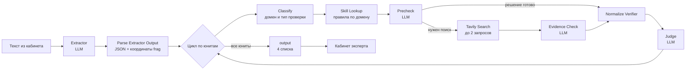

# InnoNPT · автоматическая проверка научно-популярных текстов

LLM-пайплайн, который принимает учебный или научно-популярный текст, **разбивает его на отдельные проверяемые утверждения**, проверяет каждое по источникам из интернета и возвращает структурированный JSON-вердикт. Поверх пайплайна работает веб-кабинет эксперта: текст с цветной подсветкой рисков и панелью с аргументацией и ссылками.

Студенческий проект Университета Иннополис (лето 2026) в рамках направления «научно-популярный туризм». Заказчик: ректор университета А. В. Гасников. Команда из 5 студентов.

**Моя роль (Даниил Нуриев):** архитектура и интеграция пайплайна, сравнение моделей, развёртывание на сервере, координация команды.

> Сервис работал на VPS команды, сейчас он выключен. В репозитории лежит актуальная версия (v14): экспорт воркфлоу n8n, все промпты, код узлов и интерфейс.

---

## Как это работает



1. **Extractor** делит текст на юниты. Один юнит содержит одну самостоятельно проверяемую идею. Модель возвращает строгий JSON:
   ```json
   {
     "units": [
       {
         "id": "u001",
         "frag": "дословный фрагмент исходного текста",
         "ctx": "Объект проверки - ... Проверяемое обоснование - ... Связанный контекст - ...",
         "lvl": "A | B | C"
       }
     ]
   }
   ```
   `frag` обязан быть дословным. Код-узел после модели находит каждый фрагмент в исходном тексте (точное совпадение, затем нормализация пробелов, кавычек и тире) и сохраняет `source_start` / `source_end`, чтобы интерфейс мог подсветить его.

2. **Verifier** проверяет каждый юнит в три шага:
   - `Classify` определяет предметную область (физика, химия, геология, биология) и фокус проверки (`quantity`, `attribution`, `mechanism`, `definition`, …);
   - `Skill Lookup` детерминированно, без вызова модели, подставляет правила проверки для домена и фокуса;
   - `Precheck` либо сразу выносит решение, либо формирует поисковые запросы; найденные через Tavily источники сжимаются и уходят в `Evidence Check`.

   Ответ verifier:
   ```json
   { "vv": "low_risk | medium_risk | high_risk | input_problem | cannot_verify",
     "issue": "none | fact | idea | precision | metaphor",
     "arg": "аргументация",
     "src": {"title": "...", "url": "..."} }
   ```

3. **Judge** не проверяет факт заново. Он оценивает, согласована ли вся цепочка `frag + ctx → arg → src → vv`, и выбирает итоговую категорию `pass / medium / high / error`.

4. **output** собирает результат в четыре списка (`high_expert_list`, `medium_expert_list`, `error_expert_list`, `pass_list`). Всё, что не удалось надёжно разобрать (невалидный JSON, конфликт вердиктов Judge и verifier, дубли юнитов), уходит в `error`, а не теряется молча.

## Инженерные решения

- **Разделение ролей.** Ранние версии были одним ReAct-агентом, который сам резал текст и сам проверял. Его разделил на независимые Extractor, Verifier и Judge с явными JSON-контрактами между ними: каждый шаг можно отлаживать и менять модель отдельно.
- **Разные модели под разные шаги.** Extractor и Judge работают на `deepseek-v4-flash` при `temperature = 0`; на шаги verifier, где нужно рассуждать по источникам, стоит `deepseek-v4-pro`.
- **Детерминированный код вместо LLM там, где это возможно.** Правила по доменам, построение запросов, сжатие результатов поиска, сопоставление фрагментов с текстом и маршрутизация сделаны кодом. Это дешевле, быстрее и стабильнее.
- **Устойчивый разбор ответов.** Каждый вызов модели сопровождается код-узлом, который чистит markdown-обёртки, валидирует поля по белому списку значений и при сбое помечает юнит как `error`, а не роняет весь запуск.
- **Контроль стоимости.** Ограничение `maxTokens` на каждом шаге, не больше двух поисковых запросов на юнит, сжатие найденных страниц перед передачей в модель.

## Структура репозитория

```
workflows/
  innonpt-v14.json            # рабочая версия: Webhook → пайплайн → Respond to Webhook
  innonpt-v14-chat-test.json  # та же логика с Chat Trigger для отладки в n8n
prompts/                      # системные промпты всех LLM-узлов
  extractor.md
  verifier-classify.md
  verifier-precheck.md
  verifier-evidence-check.md
  judge.md
code-nodes/                   # JavaScript всех Code-узлов (для чтения без n8n)
web/
  expert-review.html          # кабинет эксперта: ввод текста и разбор результатов
```

## Запуск

1. Поднять n8n (self-hosted, Docker) и установить community-ноду `@tavily/n8n-nodes-tavily`.
2. Импортировать `workflows/innonpt-v14.json` и создать учётные данные **OpenRouter** и **Tavily** (в экспорте вместо их ID стоят заглушки).
3. Активировать воркфлоу и скопировать Production URL узла Webhook.
4. В `web/expert-review.html` заменить `https://YOUR-N8N-DOMAIN/webhook/expert-review` на этот URL и открыть страницу через HTTP(S).

Webhook принимает `POST {"text": "..."}` (до 120 000 символов) и возвращает четыре списка, описанных выше.

## Стек

n8n · OpenRouter (DeepSeek V4) · Tavily Search · JavaScript (Code-узлы) · HTML/CSS/JS (интерфейс) · Docker, Caddy, VPS
